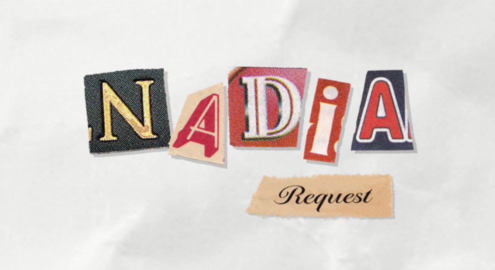
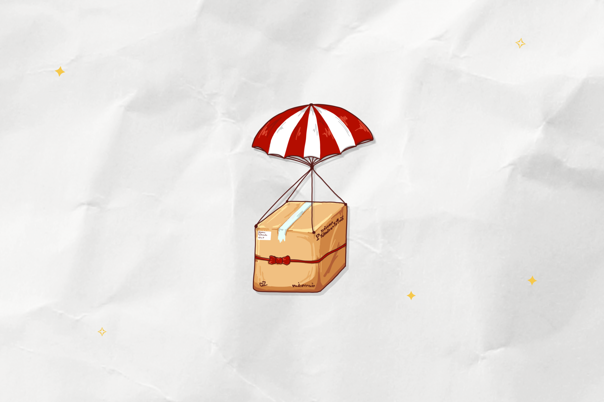
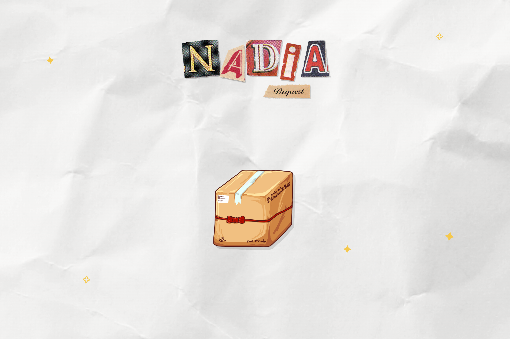
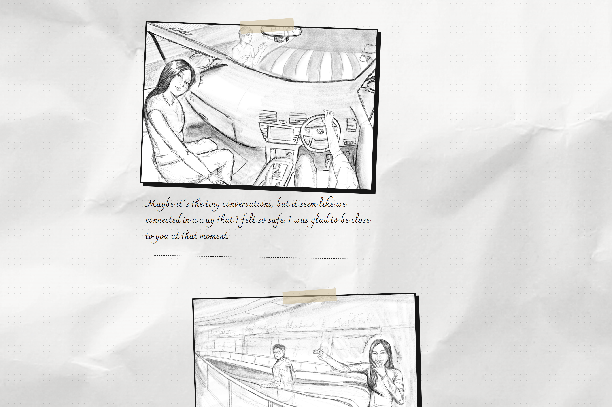
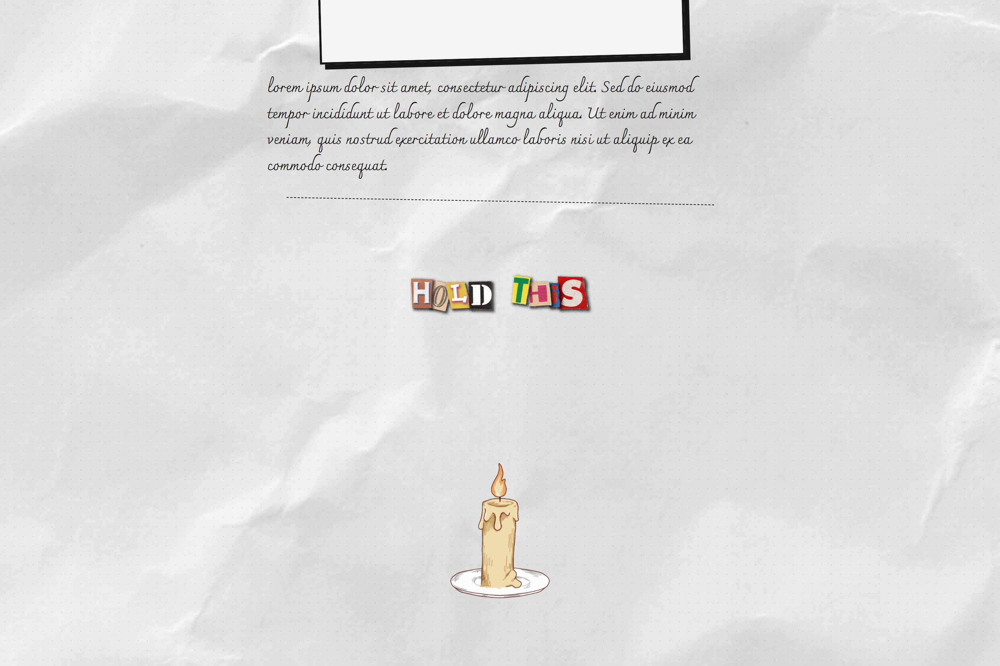

# 💐 Nadia Request

  

  
  

## ✨ Overview

**Nadia Request** is a personalized web application designed to create a unique and memorable way to express romantic feelings. It combines interactive animations, scrapbook-style storytelling, and a candlelight reveal to guide visitors through a personal story before presenting the final question.

## 💌 Experience the Project

**[Open Nadia Request →](https://github.com/Kimmuie/nadia_request.github.io/)**

## 📸 Screenshots

<table>
<tr>
<td align="center">
  
</td>
<td align="center">
  
</td>
</tr>
<tr>
<td align="center">
  
</td>
<td align="center">
  
</td>
</tr>
</table>

## ⭐ Support

Enjoyed this little project? Leave a ⭐ on the repository!

It means a lot and helps others discover this project. If you like the creativity of turning code into something personal and meaningful, your support is always appreciated. 
